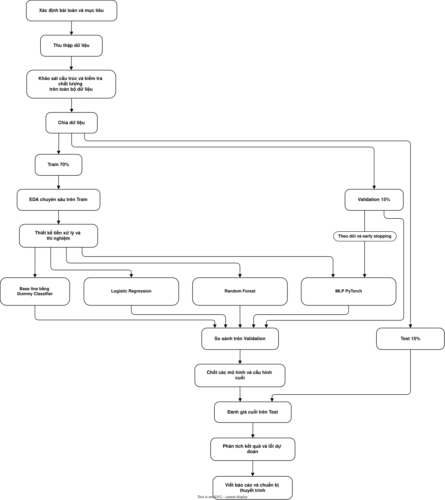

# Student Dropout & Academic Success Prediction

> Project nghiên cứu quy trình từ khám phá dữ liệu, tiền xử lý, huấn luyện đến đánh giá khả năng dự đoán tình trạng học tập của sinh viên.

Nhóm so sánh bốn phương pháp: **Dummy Classifier, Logistic Regression, Random Forest và Multilayer Perceptron (MLP) bằng PyTorch**.

## 1. Tổng quan bài toán

Đây là bài toán **học có giám sát (supervised learning)** thuộc nhóm **phân loại đa lớp (multiclass classification)**.

Từ thông tin của một sinh viên, mô hình dự đoán sinh viên đó thuộc một trong ba lớp:

| Nhãn | Ý nghĩa |
|---|---|
| `Dropout` | Bỏ học |
| `Enrolled` | Đang theo học |
| `Graduate` | Tốt nghiệp |

Mỗi sinh viên được dự đoán **một nhãn duy nhất** trong ba lớp trên.

- **Đầu vào X:** thông tin sinh viên, thông tin nhập học và kết quả học tập hai học kỳ đầu.
- **Nhãn y:** trạng thái thực tế được ghi nhận trong dataset.
- **Đầu ra dự đoán:** nhãn có xác suất cao nhất và xác suất của ba lớp.

Bốn phương pháp được xây dựng và đánh giá độc lập để so sánh hiệu quả.

## 2. Dataset

Project sử dụng bộ dữ liệu **Predict Students’ Dropout and Academic Success**, mã số **697** trên **UCI Machine Learning Repository**.

Nguồn: [UCI Machine Learning Repository](https://archive.ics.uci.edu/dataset/697/predict+students+dropout+and+academic+success).

Nhãn được xác định ở cuối thời lượng thông thường của khóa học. Thí nghiệm chính sử dụng thông tin đến học kỳ 2. Vì vậy, kết quả cần được diễn giải theo thời điểm dữ liệu có sẵn, tránh khẳng định khả năng dự đoán ngay lúc nhập học.

## 3. Mục tiêu nghiên cứu

- Khám phá đặc điểm dữ liệu và phân bố ba lớp.
- Xây dựng pipeline huấn luyện và đánh giá có thể tái hiện.
- So sánh các mô hình học máy với Dummy baseline.
- Đánh giá khả năng nhận diện từng lớp, đặc biệt lớp Dropout.
- Phân tích tác động của tiền xử lý, hyperparameter và class weight.
- Phân tích lỗi dự đoán và giới hạn của kết quả thực nghiệm.

## 4. Các phương pháp được so sánh

| Phương pháp | Vai trò | Cách tiếp cận |
|---|---|---|
| **Dummy Classifier** | Baseline | Luôn dự đoán lớp xuất hiện nhiều nhất trong Train |
| **Logistic Regression** | Mô hình tuyến tính | Học trọng số để ước lượng xác suất thuộc từng lớp |
| **Random Forest** | Mô hình tổ hợp cây | Kết hợp nhiều cây quyết định để học các quan hệ phi tuyến |
| **MLP — PyTorch** | Mạng nơ-ron | Học qua các lớp ẩn và cập nhật trọng số bằng gradient |

Dummy cung cấp mốc tham chiếu để kiểm tra mức cải thiện của các phương pháp còn lại. Mô hình phù hợp được xác định bằng thực nghiệm; độ phức tạp lớn hơn không bảo đảm kết quả tốt hơn.

## 5. Tổng quan bài toán

## 6. Tiêu chí đánh giá

**Macro-F1 là metric chính**, vì mỗi lớp đóng góp ngang nhau vào điểm trung bình, giúp nhóm đánh giá khả năng phân loại khi dữ liệu lệch lớp.

| Metric / biểu đồ | Ý nghĩa |
|---|---|
| **Macro-F1** | Trung bình đều F1 của ba lớp |
| **Accuracy** | Tỉ lệ dự đoán đúng trên toàn bộ mẫu |
| **Precision từng lớp** | Trong các mẫu được dự đoán thuộc lớp đó, bao nhiêu mẫu đúng |
| **Recall từng lớp** | Trong các mẫu thực sự thuộc lớp đó, bao nhiêu mẫu được nhận diện đúng |
| **F2 Dropout** | Kết hợp precision và recall, ưu tiên recall hơn |
| **Confusion matrix** | Thể hiện các kiểu nhầm lẫn giữa ba lớp |

Các nhánh sử dụng cùng bộ chia và hàm tính metric. Báo cáo ghi rõ cách chọn cấu hình của từng phương pháp.
