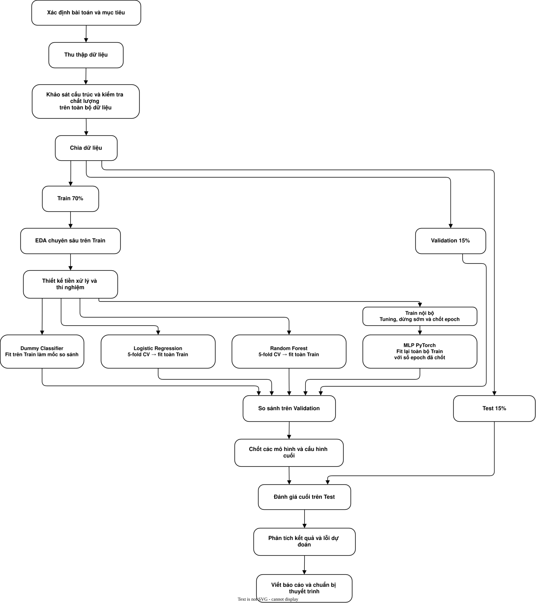

# Student Dropout & Academic Success Prediction

> Project nghiên cứu quy trình từ khám phá dữ liệu, tiền xử lý, huấn luyện đến đánh giá khả năng dự đoán tình trạng học tập của sinh viên.

Nhóm so sánh bốn phương pháp: **Dummy Classifier, Logistic Regression, Random Forest và Multilayer Perceptron (MLP) bằng PyTorch**.

## Thành viên nhóm

| STT | Họ và tên | Trường | 
|---|---|---|
| 1 | Nguyễn Hoàng Nhân | Ho Chi Minh city University of Technology, VNU-HCM |
| 2 | Bùi Quang Nhân | Ho Chi Minh city University of Technology, VNU-HCM |
| 3 | Phạm Gia Khiêm | Ho Chi Minh city University of Technology, VNU-HCM |
| 4 | Bùi Đình Hoàng Hùng | Ho Chi Minh city University of Technology, VNU-HCM | 


## 1. Tổng quan bài toán

Đây là bài toán **học có giám sát (supervised learning)** thuộc nhóm **phân loại đa lớp (multiclass classification)**.

Từ thông tin của một sinh viên, mô hình dự đoán sinh viên đó thuộc một trong ba lớp:

| Nhãn | Ý nghĩa |
|---|---|
| `Dropout` | Bỏ học |
| `Enrolled` | Đang theo học |
| `Graduate` | Tốt nghiệp |

Mỗi sinh viên được dự đoán **một nhãn duy nhất** trong ba lớp trên.

- **Đầu vào X:** thông tin sinh viên, thông tin nhập học và kết quả học tập hai học kỳ đầu.
- **Nhãn y:** trạng thái thực tế được ghi nhận trong dataset.
- **Đầu ra dự đoán:** nhãn có xác suất cao nhất và xác suất của ba lớp.

Bốn phương pháp được xây dựng và đánh giá độc lập để so sánh hiệu quả.

## 2. Dataset

Project sử dụng bộ dữ liệu **Predict Students’ Dropout and Academic Success**, mã số **697** trên **UCI Machine Learning Repository**.

Nguồn: [UCI Machine Learning Repository](https://archive.ics.uci.edu/dataset/697/predict+students+dropout+and+academic+success).

Nhãn được xác định ở cuối thời lượng thông thường của khóa học. Thí nghiệm chính sử dụng thông tin đến học kỳ 2. Vì vậy, kết quả cần được diễn giải theo thời điểm dữ liệu có sẵn, tránh khẳng định khả năng dự đoán ngay lúc nhập học.

## 3. Mục tiêu nghiên cứu

- Khám phá đặc điểm dữ liệu và phân bố ba lớp.
- Xây dựng pipeline huấn luyện và đánh giá có thể tái hiện.
- So sánh các mô hình học máy với Dummy baseline.
- Đánh giá khả năng nhận diện từng lớp, đặc biệt lớp Dropout.
- Phân tích tác động của tiền xử lý, hyperparameter và class weight.
- Phân tích lỗi dự đoán và giới hạn của kết quả thực nghiệm.

## 4. Các phương pháp được so sánh

| Phương pháp | Vai trò | Cách tiếp cận |
|---|---|---|
| **Dummy Classifier** | Baseline | Luôn dự đoán lớp xuất hiện nhiều nhất trong Train |
| **Logistic Regression** | Mô hình tuyến tính | Học trọng số để ước lượng xác suất thuộc từng lớp |
| **Random Forest** | Mô hình tổ hợp cây | Kết hợp nhiều cây quyết định để học các quan hệ phi tuyến |
| **MLP — PyTorch** | Mạng nơ-ron | Học qua các lớp ẩn và cập nhật trọng số bằng gradient |

Dummy cung cấp mốc tham chiếu để kiểm tra mức cải thiện của các phương pháp còn lại. Mô hình phù hợp được xác định bằng thực nghiệm; độ phức tạp lớn hơn không bảo đảm kết quả tốt hơn.

## 5. Tổng quan bài toán



## 6. Tiêu chí đánh giá

**Macro-F1 là metric chính**, vì mỗi lớp đóng góp ngang nhau vào điểm trung bình, giúp nhóm đánh giá khả năng phân loại khi dữ liệu lệch lớp.

| Metric / biểu đồ | Ý nghĩa |
|---|---|
| **Macro-F1** | Trung bình đều F1 của ba lớp |
| **Accuracy** | Tỉ lệ dự đoán đúng trên toàn bộ mẫu |
| **Precision từng lớp** | Trong các mẫu được dự đoán thuộc lớp đó, bao nhiêu mẫu đúng |
| **Recall từng lớp** | Trong các mẫu thực sự thuộc lớp đó, bao nhiêu mẫu được nhận diện đúng |
| **F2 Dropout** | Kết hợp precision và recall, ưu tiên recall hơn |
| **Confusion matrix** | Thể hiện các kiểu nhầm lẫn giữa ba lớp |

Các nhánh sử dụng cùng bộ chia và hàm tính metric. Báo cáo ghi rõ cách chọn cấu hình của từng phương pháp.

## 7. Cài đặt môi trường

### 7.1. Yêu cầu

- Python **3.13**.
- Visual Studio Code, cài hai extension **Python** và **Jupyter** của Microsoft.
- Dữ liệu gốc của dự án.

Project có thể chạy hoàn toàn bằng **CPU**, không bắt buộc có **GPU**.

Môi trường đã dùng để kiểm tra:

| Thành phần | Phiên bản |
|---|---|
| Python | 3.13.14 |
| scikit-learn | 1.9.1 |
| PyTorch | 2.15.0+cpu |

### 7.2. Tạo môi trường ảo và cài thư viện

Mở toàn bộ thư mục `student-dropout-prediction` trong VS Code, sau đó chọn **Terminal → New Terminal**.

Terminal cần nằm tại thư mục gốc, nơi có `README.md`, `requirements.txt`, `common/` và `notebooks/`.

Chạy các lệnh sau trong PowerShell:

```powershell
# Tạo môi trường ảo bằng Python 3.13.
python -m venv .venv

# Cập nhật pip trong môi trường của dự án.
.\.venv\Scripts\python.exe -m pip install --upgrade pip

# Cài các thư viện cần thiết.
.\.venv\Scripts\python.exe -m pip install -r requirements.txt
```

Nếu đã có `.venv` của dự án, bỏ qua lệnh tạo môi trường và chạy các lệnh cài thư viện.

Các lệnh trên gọi trực tiếp Python trong `.venv`, nên không cần kích hoạt môi trường trước.

### 7.3. Chọn kernel cho notebook

Mở một file `.ipynb`, nhấn **Select Kernel** ở góc trên bên phải rồi chọn môi trường `.venv` của dự án.

Đường dẫn Python cần kết thúc bằng:

```text
.venv\Scripts\python.exe
```

Có thể kiểm tra trong một cell:

```python
import sys
print(sys.executable)
```

Thực hiện việc chọn kernel cho từng notebook trước khi chạy. Kernel quyết định môi trường Python và thư viện mà notebook sử dụng.

## 8. Chuẩn bị dữ liệu

Đặt file CSV gốc tại:

```text
data/raw/data.csv
```

Nếu chưa có, tải bộ dữ liệu từ liên kết UCI ở mục 2, giải nén và đặt `data.csv` vào đúng vị trí trên.

Giữ nguyên dữ liệu gốc. Notebook đã xử lý việc đọc CSV bằng dấu phân cách `;` và bỏ khoảng trắng thừa quanh tên cột.

Bộ chia và năm fold dùng chung được lưu tại:

```text
data/splits/splits.json
```

Notebook chuẩn bị dữ liệu sẽ kiểm tra và sử dụng lại bộ chia đã lưu. Cả nhóm dùng chung file này để so sánh trên cùng các mẫu Train, Validation và Test.

## 9. Thứ tự chạy notebook

Chạy lần lượt theo bảng dưới đây. Với mỗi notebook:

1. Chọn đúng kernel `.venv`.
2. Khởi động lại kernel nếu notebook đã được chạy trước đó.
3. Chọn **Run All** để chạy từ đầu đến cuối.
4. Chờ hoàn tất và kiểm tra không có cell báo lỗi.
5. Lưu notebook trước khi chuyển sang bước tiếp theo.

| Bước | Notebook | Công việc |
|---|---|---|
| 1 | `notebooks/data_preparation/00_prepare_data.ipynb` | Đọc và kiểm tra dữ liệu; tạo hoặc kiểm tra bộ chia cùng năm fold dùng chung. |
| 2 | `notebooks/data_preparation/01_eda_train.ipynb` | Phân tích Train, kiểm tra ngoại lai, xuất bảng và biểu đồ; giải thích quyết định tiền xử lý. |
| 3 | `notebooks/models/dummy/01_dummy_classifier.ipynb` | Fit Dummy trên Train, đánh giá Validation và lưu baseline. |
| 4 | `notebooks/models/logistic/02_logistic_regression.ipynb` | Tuning Logistic bằng năm fold trên Train, fit lại toàn bộ Train và đánh giá Validation. |
| 5 | `notebooks/models/random_forest/04_random_forest.ipynb` | Tuning RF bằng cùng năm fold, fit lại Train, đánh giá Validation và phân tích đặc trưng. |
| 6 | `notebooks/models/mlp/05_mlp.ipynb` | Tuning và chọn epoch trong phần nội bộ của Train; fit lại toàn bộ Train rồi đánh giá Validation chung. |
| 7 | `notebooks/evaluation/06_compare_validation.ipynb` | Kiểm tra kết quả bàn giao, ghép bảng Validation và chọn mô hình theo Macro-F1. |
| 8 | `notebooks/evaluation/07_evaluate_test.ipynb` | Nạp lại bốn mô hình đã chốt, đối chiếu Validation và đánh giá cuối trên Test. |

Các notebook mô hình tự gọi bộ tiền xử lý và hàm metric trong `common/`, không cần chạy riêng các file Python trong thư mục này.

Phần tuning có thể mất nhiều thời gian:

- Logistic: **42 cấu hình × 5 fold = 210 lượt fit**.
- Random Forest: **16 cấu hình × 5 fold = 80 lượt fit**.
- MLP: **12 cấu hình × 3 seed = 36 lượt tuning**, sau đó fit mô hình cuối trên toàn bộ Train.

Thời gian chạy phụ thuộc cấu hình máy.

## 10. Kết quả được lưu ở đâu?

| Vị trí | Nội dung |
|---|---|
| `data/splits/splits.json` | Chỉ số dòng của Train, Validation, Test và năm fold. |
| `reports/tables/eda_train/` | Thống kê, kiểm tra chất lượng dữ liệu và quyết định xử lý ngoại lai. |
| `reports/tables/dummy/` | Kết quả Dummy baseline. |
| `reports/tables/logistic/` | Bảng tuning và kết quả Validation của Logistic. |
| `reports/tables/random_forest/` | Bảng tuning, kết quả Validation và phân tích RF. |
| `reports/tables/mlp/` | Kết quả tuning, lịch sử huấn luyện và Validation của MLP. |
| `reports/tables/comparison/validation_summary.csv` | Bảng so sánh Validation của bốn phương pháp. |
| `reports/tables/test/test_summary.csv` | Bảng kết quả Test cuối cùng. |
| `reports/figures/` | Các biểu đồ EDA và đánh giá mô hình. |
| `artifacts/` | Pipeline, preprocessing, checkpoint và thông tin cấu hình đã lưu. |

## 11. Lưu ý khi chạy và tái hiện kết quả

- Giữ nguyên dữ liệu gốc, bộ chia, fold và seed để đối chiếu kết quả.
- Preprocessing chỉ được fit trên phần dữ liệu dùng để học ở từng giai đoạn, Validation và Test chỉ được transform.
- Chạy đủ bốn notebook mô hình trước khi chạy hai notebook đánh giá chung.
- Chốt lựa chọn bằng kết quả Train/CV và Validation trước khi xem Test. Không dùng điểm Test để điều chỉnh cấu hình.
- Có thể chạy lại đánh giá Test để kiểm tra tính tái hiện với các mô hình đã khóa.
- Chạy lại notebook sẽ cập nhật các file kết quả tại những đường dẫn trên. Sao lưu kết quả cũ trước nếu cần giữ nhiều thí nghiệm.
- Phiên bản thư viện và cấu hình được ghi trong các file JSON đi kèm mô hình. Thay đổi phiên bản thư viện hoặc chuyển CPU/GPU có thể làm kết quả khác nhẹ.